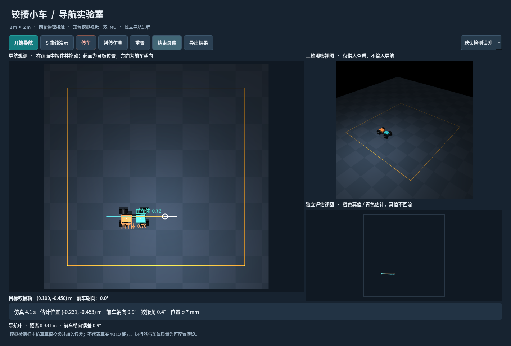

# 铰接四轮小车导航仿真

独立的新工程。没有复用原车辆模型、导航代码或参数；没有 ROS、串口、CAN、SSH 或实车驱动接口。

当前验证：固定默认误差测试 **50/50 通过**，全部未越界、未超铰接限位；3 次曲线和 8 组参数扰动通过。高噪声档有一次实际朝向超差，已如实记录。详见 [验证报告](验证报告.md)。



2026-11-02 的验收摘要、界面截图与隔离检查结果随仓库保存在 [validation/2026-11-02](validation/2026-11-02/README.md)。本机 `runs/` 原始日志、`.venv/` 环境和 `.runtime/` 运行库不纳入 Git；安装脚本会在新机器上创建环境。

## 从 GitHub 安装

已验证环境为 Ubuntu 22.04、系统 Python 3.10、NVIDIA GPU/EGL。需要 GitHub 仓库访问权限；仓库默认私有。

```bash
gh repo clone waxer-501/articulated-car-navigation-sim
cd articulated-car-navigation-sim
./安装环境.sh
./启动仿真.sh
```

## 启动

本机已在 `.venv/` 安装 Python 3.10 环境。打开本机桌面终端执行：

```bash
cd /home/gyt/钻探小车/铰接小车仿真
./启动仿真.sh
```

在顶置画面中**按住鼠标并拖动**：按下位置为目标铰接轴位置，拖动方向为目标前车朝向。点击“开始导航”。小车允许倒车，后车体不要求在终点回正。仅点击、不拖动时使用当前估计的前车朝向。

- **S 曲线演示**：从当前估计位置生成可重复的曲线；建议先重置。若曲线超出场地，则明确拒绝。
- **停车**：取消任务，清除尚未执行的延迟驱动指令，用模拟电机阻尼减速；铰接机构保持，不自动回中。
- **暂停仿真**：冻结物理时间，不等于执行停车；继续时恢复原任务。
- **重置**：保存本次结果，创建新运行，恢复配置中的初始姿态并重新视觉定位、IMU 标定。
- **录像**：保存采集时刻对应的原始顶置 RGB 视频；检测框、轨迹和输入输出另存日志。
- **导出结果**：刷新当前运行的 `report.json` 和日志。关闭窗口也会保存。
- 切换检测误差档会保存旧运行、创建新实验。三维观察和真值评估图仅供人查看。

没有桌面显示服务时仍可运行批量仿真；GUI 需要本机图形会话。离屏渲染默认使用 EGL。首次复制到其他机器时运行 `./安装环境.sh`；安装脚本只写本工程虚拟环境，不修改系统 Python。

本机缺少的 `libxcb-cursor0` 已从 Ubuntu 22.04 软件包提取到 `.runtime/`，由本工程加载，不进行系统级安装。

桌面依赖固定为 PySide6 6.8.3。本机 Python 3.10 与初装的 PySide6 6.12 在持续绘图中出现 `none_dealloc` 崩溃，故更换并增加十万次绘图回归及原生桌面持续运行检查；失败日志保留在 `runs/desktop_launch.log`。

## 场景与假设

场地为 `[-1,1] × [-1,1] m`，平地且无障碍物。物理步长 2.5 ms。车辆有前后两个刚体、四个独立滚动轮和一个竖直铰接关节。除初始化/重置外，位置只能由 MuJoCo 积分改变。

| 参数 | 数值 / 来源 |
|---|---|
| 轮径 / 胎宽 | 0.103 / 0.040 m，用户确认 |
| 同轴轮心距 / 外缘总宽 | 0.140 / 0.180 m，用户确认 |
| 铰接轴至前、后轮轴线 | 0.110 / 0.120 m，用户确认 |
| 铰接范围 | ±40°，用户确认；数值接触限位提前 0.1°吸收柔性限位穿透 |
| 转向输入 | 比例控制转向快慢；松手保持，用户确认 |
| 驱动分配 | 四轮共同驱动，待实车确认 |
| 总质量 | 1 kg 假设；前后车体各 0.4 kg，轮子各 0.05 kg |
| 车体外壳 | 简化长方体加连接件；尺寸、质量和惯量是仿真假设 |
| 导航限速 / 转向速率上限 | 0.15 m/s / 30°/s，工程初值 |
| 顶置相机 | 中心上方 2 m，1024²，30 Hz，65°垂直视场角 |
| 双 IMU | 200 Hz，三轴比力（包含重力作用）和三轴角速度 |

所有参数集中在 `configs/default.yaml`。实际玩具车的内部闭环仍未知；本模型用有延迟、死区、有限力矩和保持特性的执行器模拟外部行为。速率执行器内部状态不会输出给导航，也不构成对实车控制器结构的判断。

## 信息边界和接口

```text
MuJoCo 物理世界 ─→ 相机投影 / 模拟检测框 / 双 IMU ─→ 独立导航进程
       ↑                                              │
       └──────────── drive、steer 两个归一化输入 ────────┘
       │
       └→ 独立评估、记录与人用观察画面（不回流导航）
```

导航子进程由 `multiprocessing spawn` 启动，不继承物理世界对象。启动参数仅含已知几何、相机标定和导航配置，**不含初始姿态、仿真随机种子或实际动力学参数**。导航不导入 MuJoCo 模块、不读取真值文件。此为应用级接口隔离，不宣称操作系统对恶意进程的安全沙箱。

公共数据约定：米、秒、弧度；世界 x 向图像右方、y 向图像上方；航向从世界 +x 逆时针增加。铰接角 `α = 前车航向 − 后车航向`。

- IMU：`kind, time, front/rear:{accel:[3], gyro:[3]}`。时间为仿真采集时间。
- 视觉：`kind, time, detections:[{class, box:[x1,y1,x2,y2], confidence}]`。类别只有 `front/rear`，框坐标单位为像素。
- 目标：`[pivot_x, pivot_y, front_yaw]`。终点后车朝向自由，但完整车身必须在场内。
- 控制：`[drive, steer] ∈ [-1,1]²`；前者为归一化电机驱动量，后者为归一化铰接速率需求，均不是实际测量值。
- RGB 可供显示和将来真实检测器使用；首版导航消费模拟检测框，不运行真实 YOLO。

模拟检测器由车体真实三维包围盒投影得到像素框，射线检查可见性，并加入中心和尺寸噪声、缓慢偏移、漏检、低频误检及队列延迟。默认 3 px 中心标准差、5% 尺寸误差、5% 漏检、100 ms 延迟；理想和压力档也在配置中。遮挡模拟用于抑制不可见目标，不是逼真的神经网络误差模型。

## 导航实现

- EKF 状态：铰接轴 x/y、前后航向、估计前轴纵向速度、两只陀螺零偏。启动时保持静止，先通过检测框拟合位置与朝向、估计 IMU 零偏。
- 视觉更新使用已知车体高度的完整投影模型，不将框中心直接当作地面点；采用创新门限拒绝离群框。
- 保存 IMU 时间缓冲。延迟视觉先更新对应历史时刻，再重放后续 IMU；不能把过去图像当作当前观测。
- Hybrid A* 搜索 x/y、前车航向、铰接角，包含前进、倒退与换向成本。所有路径采样和 MPC 预测都检查铰接后的前后外壳及轮胎范围。
- MPC 根据估计状态输出电机指令；在换向处减速，终点受限时重新规划前后调整。预测模型独立于实际仿真动力学。
- 视觉过期、不确定度过大时停车等待；可观测性恢复后继续原任务。不可达目标返回明确原因。规划/控制计算期间仿真时间停止推进，不用过期指令偷偷推进物理世界。
- 到达判断来自估计状态。独立评估要求真值位置 ≤5 cm、前车朝向 ≤5°、实际速度 ≤1 cm/s、角速度 ≤1°/s，并连续稳定至少 1 秒。

## 命令行与验收

所有命令只在开发电脑进行纯仿真，不会使任何实车、机械臂或主轴动作。`Ctrl+C` 结束运行；重置和重新运行只作用于新仿真。正常演示的模拟时间约 10–30 秒，困难姿态可能更长；墙钟时间取决于规划、渲染与机器负载，日志会同时记录两者。

```bash
# 指定位置与前车朝向；CLI 角度采用度
.venv/bin/python -m artic_nav.cli run --goal 0.45 0.15 45

# S 曲线与原始相机录像
.venv/bin/python -m artic_nav.cli run --curve --video

# 相机中断：第 3 到第 6 个模拟秒无检测
.venv/bin/python -m artic_nav.cli run --blackout 3 6

# 10 组固定姿态 × 5 个种子，默认误差
.venv/bin/python -m artic_nav.cli batch --suite acceptance --jobs 4

# 理想/默认/压力档、相机中断、曲线及不可达目标
.venv/bin/python -m artic_nav.cli batch --suite stress --jobs 2

# 质量、摩擦、驱动力矩、执行延迟扰动
.venv/bin/python -m artic_nav.cli batch --suite sensitivity --jobs 2

# 自动化检查（包括离屏 GUI 交互）
QT_QPA_PLATFORM=offscreen .venv/bin/python -m pytest -q

# 只重放传感器，输出导航结果摘要；不接受真值输入
.venv/bin/python -m artic_nav.cli replay --requests runs/某次运行/sensor_requests.jsonl.gz
```

默认单次实验上限为 180 个模拟秒；该上限只是仿真实验预算，不是车端超时。完成应立即进入停车确认，不会为凑满上限继续行驶。中断实验与未通过验收必须保留为失败/未完成，不算成功。

每次运行保存：

- `config.yaml`、`model.xml`：有效配置及物理模型。
- `sensor_requests.jsonl.gz`：实际送入导航进程的观测、目标和操作，包含丢帧与延迟结果。
- `navigation.jsonl`：估计状态、命令、任务状态与不确定度。
- `planned_path.json`：规划参考。
- `truth_evaluation_only.jsonl`：独立真值，禁止作为导航输入。
- `report.json`：实际终点误差、停车保持、越界、关节限位、循迹与定位 RMS。
- `overhead.mp4`：启用录像时的原始相机帧。

批量报告位于相应目录的 `summary.json`。默认档 50 次到点测试成功率至少 90%、全程无越界和关节超限才通过该项验收。压力档允许明确失败，不能借放宽验收阈值伪装通过。真实 YOLO、真实玩具车动力学、真实相机标定与实车导航均未验证。
